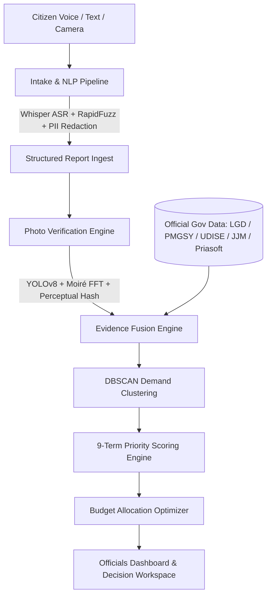

# AwaazIQ (ComplainBox) — Intelligent Rural Infrastructure Governance

> **From Citizen Voice to Evidence-Backed Public Action**  
> AwaazIQ bridges the gap between rural citizens and public administration by converting unstructured, multilingual complaints into prioritized, fraud-verified, and budget-optimized civic action.

[](https://frontend-psi-seven-99.vercel.app/)
[](https://idk-production-2d30.up.railway.app/docs)
[](https://fastapi.tiangolo.com/)
[](https://ultralytics.com/)

---

## 🔗 Live Deployment

| Service | Access Link | Description |
| :--- | :--- | :--- |
| **Officials Dashboard** | [https://frontend-psi-seven-99.vercel.app/](https://frontend-psi-seven-99.vercel.app/) | Geo-spatial cluster map, village priority rankings, asset detail docks & explainers |
| **Citizen Intake Portal** | [https://frontend-psi-seven-99.vercel.app/report.html](https://frontend-psi-seven-99.vercel.app/report.html) | Vernacular voice/text reporting, interactive GPS pin picker & authenticated camera capture |
| **Photo Verification Lab** | [https://frontend-psi-seven-99.vercel.app/photo-lab.html](https://frontend-psi-seven-99.vercel.app/photo-lab.html) | Interactive suite for testing computer vision & anti-fraud defense on evidence photos |
| **Backend API Docs** | [https://idk-production-2d30.up.railway.app/docs](https://idk-production-2d30.up.railway.app/docs) | Interactive OpenAPI / Swagger documentation |

---

## 💡 The Problem & The Solution

### The Challenge in Rural Civic Redressal
1. **Loud Voice Bias**: Public funding and repairs disproportionately favor noisy, politically connected areas over quiet, vulnerable, underserved hamlets.
2. **Fraud & Misinformation**: Recycled stock photos, camera captures of digital screens, and duplicate complaints waste municipal bandwidth.
3. **Siloed Data**: Citizen grievances remain disconnected from official administrative databases (PMGSY roads, UDISE+ schools, Jal Jeevan Mission, MGNREGA expenditures, Census 2011).
4. **Language & Literacy Barriers**: Villagers express grievances in local dialects (Hindi, Marathi, Hinglish) via voice or colloquial text that traditional portals fail to parse.

### How AwaazIQ Solves It
* **Multi-Modal Vernacular Intake**: Ingests voice and text complaints in Hindi, Marathi, English, and mixed dialects, extracting civic categories, sentiment, severity, and location.
* **Fake-Complaint & Photo Defense**: Verifies that photos are taken in real-time on-site using GPS validation, Moiré frequency pattern analysis (anti-screen recapture), duplicate perceptual hashing, and YOLOv8 defect detection.
* **Ground-Truth Evidence Fusion**: Cross-corroborates complaints with 12+ authoritative government datasets to confirm actual asset deficits before approving works.
* **Transparent 9-Term Priority Score**: Eliminates black-box bias. Every score is mathematically broken down into nine explicit terms that explain exactly why one issue outranks another.
* **Algorithmic Budget Optimizer**: Utilizes a 0/1 knapsack optimizer to recommend the highest-impact allocation of Gram Panchayat and municipal funds within specified budgets.

---

## 📐 System Architecture



---

## 🚀 Key Modules & Capabilities

### 1. AI/NLP Vernacular Intake Pipeline (`pipeline/`)
* **Language Identification**: Custom classifier detecting `hi-Deva`, `mr-Deva`, `hi-Latn` (Hinglish), and `en`, while cleanly flagging unsupported scripts.
* **Speech-to-Text (ASR)**: Constrained `faster-whisper` implementation with Voice Activity Detection (VAD) and curated civic vocabulary prompts.
* **Issue & Severity Extraction**: Domain lexicon matching across 4 critical infrastructure pillars: **Roads**, **Water**, **Health Facilities**, and **Education / Schools**.
* **Fuzzy Geocoding**: High-precision extraction of village and hamlet names mapped against OpenStreetMap and Census gazetteers.
* **Automatic PII Redaction**: Strips phone numbers, personal identifiers, and private metadata before persistence.

### 2. Fake-Complaint Defense & Computer Vision (`backend/photo_checks.py`, `models/`)
* **Camera Attestation (C1)**: Restricts photo capture to live device camera with GPS coordinates and timestamps pinned at shutter press.
* **Account-Weighted Clustering (C2)**: Prevents single-user botting by counting unique verified identities rather than raw submission counts.
* **Perceptual Duplicate Detection (C3)**: Image hashing (`imagehash`) identifies and flags recycled or cross-village duplicate photos.
* **Metadata & Edit Analysis (C4)**: Inspects EXIF software tags and generates Error-Level Analysis (ELA) heatmaps for altered images.
* **Road Defect Detection (C5)**: Custom trained YOLOv8 model (`models/pothole_best.pt`) detecting potholes and severe road cracking with bounding box annotations.
* **Structure & Bridge Damage Assessment (C6)**: Vision model classifies structural damage severity (cracked, partial failure, collapsed).
* **Anti-Screen Replay Check (C7)**: 2D FFT frequency spectrum analysis detects Moiré patterns caused when a phone camera photographs a computer monitor or printout.

### 3. Intelligence Engine & 9-Term Scoring (`intelligence/`)
AwaazIQ computes a transparent, explainable priority score for every demand cluster and village asset:

$$\text{Priority Score} = (\text{Gap Score} \times \text{Confidence Gate}) + \text{Equity} + \text{Strategic} + \text{Urgency} + \text{Feasibility} - \text{Cost}$$

* **Demand**: Clustered citizen reports weighted by recency decay and trust scores.
* **Population Affected**: Real Census 2011 settlement populations within category-specific catchment radiuses.
* **Infrastructure Deficit**: Real UDISE+ school condition, JJM tap coverage deficits, and PMGSY road conditions.
* **Vulnerability**: Remote settlement and historical marginalization indicators.
* **Equity**: Guaranteed baseline boost for low-connectivity and underserved talukas.
* **Strategic Alignment**: Alignment with GPDP and district master plans.
* **Urgency**: Critical emergency corroboration (CWC river levels, SACHET disaster alerts).
* **Feasibility**: Distance to district headquarters, available road access, and technical viability.
* **Cost**: Estimated project expenditure based on standard Schedule of Rates.

### 4. Ground-Truth Data Integration
AwaazIQ integrates genuine datasets covering the pilot districts of **Kolhapur** and **Nashik**:
* **Local Government Directory (LGD)**: Complete administrative hierarchy (States, Districts, Blocks, Panchayats, Villages).
* **PMGSY GeoSadak**: 97,000+ rural road features with exact GIS LineString geometries.
* **UDISE+ School Infrastructure**: Comprehensive school condition records (classrooms, electricity, drinking water, boundary walls).
* **Jal Jeevan Mission (JJM)**: Village-level tap water schemes, implementation status, and water-quality lab testing data.
* **Panchayat Finances (Priasoft)**: Gram Panchayat balance sheets, receipts, and 15th Finance Commission expenditures.
* **MGNREGA**: Village-level public works expenditure.
* **Central Water Commission (CWC) & SACHET**: Telemetry river gauge levels and disaster warning feeds.

---

## 🛠️ Project Structure

```plaintext
AwaazIQ/
├── backend/                  # FastAPI Application & Business Logic
│   ├── main.py               # API server setup & routing
│   ├── database.py           # Database connection & session management
│   ├── models.py             # SQLAlchemy schemas (30 tables)
│   ├── photo_checks.py       # Computer vision & anti-fraud verification
│   ├── routes_*.py           # API endpoints (citizen, dashboard, villages, photo)
│   ├── load_*.py             # Real government dataset ETL pipelines
│   └── data/                 # Raw GIS shapefiles, GeoJSON, and CSV datasets
├── frontend/                 # Interactive Web Portals (Vanilla HTML5/CSS3/JS)
│   ├── index.html            # Officials interactive command center
│   ├── report.html           # Citizen multi-modal complaint filing
│   ├── photo-lab.html        # Interactive photo verification test suite
│   ├── signin.html           # Official and citizen authentication
│   ├── css/                  # Curated responsive design system & explainers
│   └── js/                   # Leaflet map controllers, explainers, API client
├── intelligence/             # Core Priority Scoring & Optimization Engine
│   ├── clustering.py         # Category-specific DBSCAN spatial clustering
│   ├── scoring.py            # 9-term mathematical score computation
│   ├── recompute.py          # End-to-end score aggregation & ranking
│   ├── budget_optimizer.py   # 0/1 Knapsack capital allocation optimizer
│   ├── realdata.py           # Government data evidence lookup helpers
│   └── WEIGHTS.md            # Complete documentation of scoring weights & logic
├── models/                   # Machine Learning Models
│   ├── pothole_best.pt       # Trained YOLOv8 road defect detector weights
│   ├── eval_manifest.json    # Labeled image benchmark manifest
│   └── README.md             # Model architecture & accuracy evaluation
├── pipeline/                 # Vernacular NLP Intake Pipeline
│   ├── asr.py                # Whisper speech-to-text with VAD
│   ├── lang_id.py            # Language identification (hi, mr, en, Hinglish)
│   ├── extract.py            # Entity, category, and severity extraction
│   └── geocode.py            # Fuzzy village gazetteer geocoding
├── docs/                     # Architectural diagrams, build plans, and audits
└── README.md                 # Project documentation
```

---

## ⚡ Quick Start & Local Setup

### 1. Prerequisites
* Python 3.10+
* Virtual environment (`venv`) recommended

### 2. Installation
Clone the repository and install dependencies:

```bash
git clone https://github.com/Tabsirshaikh/AwaazIQ.git
cd AwaazIQ

# Install backend dependencies
cd backend
pip install -r requirements.txt

# Install pipeline dependencies
cd ../pipeline
pip install -r requirements.txt
cd ..
```

### 3. Running Locally

**Start the Backend API:**
```bash
cd backend
python -m uvicorn main:app --host 127.0.0.1 --port 8001
```
*API interactive documentation will be accessible at:* `http://127.0.0.1:8001/docs`

**Serve the Frontend:**
In a separate terminal from the repository root:
```bash
python -m http.server 5500 --bind 127.0.0.1 --directory frontend
```

Now open your browser:
* **Officials Dashboard:** [http://127.0.0.1:5500/index.html](http://127.0.0.1:5500/index.html)
* **Citizen Complaint Portal:** [http://127.0.0.1:5500/report.html](http://127.0.0.1:5500/report.html)
* **Photo Verification Lab:** [http://127.0.0.1:5500/photo-lab.html](http://127.0.0.1:5500/photo-lab.html)

---

## 📊 Summary of Pilot Coverage

* **Focus Districts**: Kolhapur & Nashik (Maharashtra)
* **Gazetteer Coverage**: 1,042 villages and taluka headquarters
* **Sanctioned Public Facilities**: 10,464 named facilities (9,352 UDISE schools + 1,112 health facilities)
* **Road Network LineStrings**: 8,063 PMGSY GeoSadak road segments
* **Demographic Grounding**: 91% of settlements mapped with Census 2011 population figures
* **Intake Processing**: 2,100+ analyzed reports clustered into active demand units
